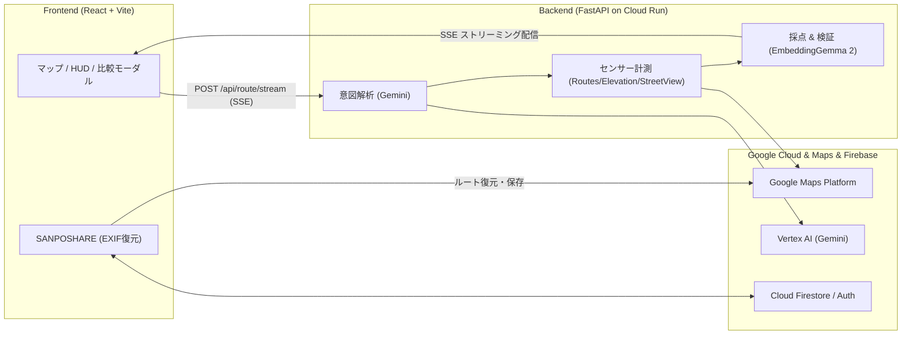

# Walkmaxxing

[](https://www.typescriptlang.org/)
[](https://react.dev/)
[](https://fastapi.tiangolo.com/)
[](https://developers.google.com/maps)
[](https://deepmind.google/technologies/gemini/)
[](https://ai.google.dev/)
[](LICENSE)

> **「最短距離」の先へ。歩行体験を最大化（Maxxing）し、歩行者（Walkmaxxer）の気分・体調・都市環境をマルチモーダルに推論するAI徒歩ナビ ＆ 散歩共有プラットフォーム**

---

## 背景とストーリー

| ステップ | 内容 |
| :--- | :--- |
| **1. 問題 (Problem)** | 最短重視の既存ナビでは「坂を避けたい」「安全な道がいい」「30分だけ散歩したい」といった歩行者（Walkmaxxer）の身体的・心理的ニーズに応えられない。コース共有の仕組みも不足。 |
| **2. 発想 (Idea)** | 「Walkmaxxerの曖昧な気分・要望」と「都市の客観センサー（標高・実景・街灯）」を掛け合わせ、散歩体験を最大化（Walkmaxxing）。さらに「写真のGPSを繋ぐだけ」でコースを共有・追体験できるようにする。 |
| **3. 実装 (Implementation)** | **Gemini**（意図抽出・進行方向Street View視覚査定）× **Google Maps Platform**（Routes/Elevation/Places）× **EmbeddingGemma 2**（オンメモリ意味リランキング & 幾何学折り返し検知）。 |
| **4. 解決 (Solution)** | 標準ルートとの客観比較（標高断面・実景写真）で納得して選択でき、完歩後は写真をアップするだけで全国のWalkmaxxerと街の散策体験を循環共有できるプラットフォームを実現。 |

---

## 主な機能

1. **マルチモーダル徒歩ルート探索**
   - **意図解析 & オンデマンドAPI連携**: 「ベビーカー優先」「坂を避ける」「日陰中心」などWalkmaxxerの自由入力から要件を抽出し、必要なAPIのみ最小限に呼び出し。
   - **進行方向 Street View 視覚査定**: 進行方向（約15m先）の実景画像をGemini Visionで観察し、歩道・道幅・街灯・景観を査定。
   - **タイムドループ（周回散歩）**: 15〜60分の指定時間に合わせて現在地発着の周回ルートを自動生成。
2. **EmbeddingGemma 2 × 幾何学品質フィルタ**
   - **意味類似度リランキング**: LiteRT-LM (270M) をオンメモリ実行し、Walkmaxxerの要望と実測ルートの意味適合度を高速スコアリング。
   - **不自然な折り返し検知**: 10mグリッド走査でヒゲ状の無駄な往復を自動減点・除外。
3. **標準ルートとの客観比較**
   - 地図上での重ね合わせ表示（標準: 破線 / 提案: 実線）、所要時間・距離差分、**標高断面SVGチャート**、実景写真の比較モーダル。
4. **散歩シェア（SANPOSHARE）**
   - 写真のEXIF GPS情報から撮影順の実道路ルートを自動復元。Firestoreトランザクション保護 & 14日TTL新陳代謝で、Walkmaxxer同士が最新コースを共有・追体験。
5. **テーマ着せ替え ＆ 多言語対応**
   - Modern（現代風すりガラス） / Traditional（和風絵巻）のUI切り替え、日・英・中3言語リアルタイム対応。

---

## システムアーキテクチャ



---

## 📂 ディレクトリ構成

```text
.
├── backend/                  # FastAPI バックエンド (Cloud Run)
│   ├── app/
│   │   ├── main.py           # API ルーター & SSE ストリーミング配信
│   │   ├── models.py         # リクエスト / レスポンス等の Pydantic モデル定義
│   │   └── services/         # Gemini連携、Maps/標高計測、EmbeddingGemma推論
│   ├── Dockerfile            # Cloud Run 本番用コンテナ定義
│   └── requirements.txt      # バックエンド依存関係
└── frontend/                 # React + TypeScript + Vite フロントエンド
    ├── public/               # 静的アセット（アイコン、SVG、ファビコン）
    ├── scripts/              # ルール・ルート回帰検証スクリプト
    ├── src/
    │   ├── components/       # HUD、マップ、標高チャート、モーダル等のUI部品
    │   ├── data/             # 地図スタイル、施設ピン、プリセットデータ
    │   ├── i18n/             # 多言語対応リソース（日・英・中）
    │   ├── services/         # API通信、EXIF GPS解析、Firebase/Firestore連携
    │   ├── types/            # ルート、散歩、テーマ等の型定義
    │   └── utils/            # ユーティリティ関数
    ├── firebase.json         # Firebase Hosting & Firestore 設定
    └── package.json          # フロントエンド依存関係 & スクリプト
```

---

## クイックスタート

APIキー未設定時は自動的にモックモードで起動します。

### 1. バックエンド (`http://localhost:8080`)
```bash
cd backend
python3 -m venv .venv && source .venv/bin/activate
pip install -r requirements.txt
cp .env.example .env  # 実API利用時
uvicorn app.main:app --reload --port 8080
```

### 2. フロントエンド (`http://localhost:5173`)
```bash
cd frontend
npm install
npm run dev
```

### 3. テスト
```bash
# バックエンド
PYTHONPATH=backend backend/.venv/bin/python -m unittest discover -s backend/tests -q
# フロントエンド
npm --prefix frontend run build
```


---


# DevFest Hackathon 2026 提出用リポジトリ

  DevFest Hackathon 2026 のチームの **最終提出用** リポジトリです。提出期限までに、作品のコードと資料をこのリポジトリに置いてください。

  このリポジトリは **公開（public）** です。開催中も、運営・審査員・ほかの参加者が見られます。

  ## はじめに

  1. GitHub から届いた招待を受け入れてください（招待の期限は 7 日です）
  2. このリポジトリを clone して、提出物を置いてください

  招待の期限が切れたときや、メンバーが変わったときは、運営に連絡してください。

  ## 開発用のリポジトリは別に作ることをおすすめします

  このリポジトリでは **GitHub Actions と GitHub Pages が使えません**。CI やデプロイ、Pages での公開をしたいときは、チームで開発用のリポジトリを別に作ってください。

  - 開発用のリポジトリは、チームのメンバーのアカウントや、チームで作った Organization に作ってください
  - 開発はそちらで進めて、提出期限までに最終版のコードと資料をこのリポジトリに push してください
  - 審査はこのリポジトリの内容で行います。開発用のリポジトリにしかないものは、審査の対象になりません
  - デプロイした作品の URL があれば、この README に書いてください

  ## 秘密情報をコミットしない

  API キー・パスワード・サービスアカウントの鍵などは、**絶対にコミットしないでください**。公開リポジトリなので、push
  した時点で誰でも見られます。開発用のリポジトリから持ってくるときも、履歴ごと push すると、過去のコミットに含まれる秘密情報も公開されます。

  - 秘密情報は `.env` や `.dev.vars` などに書き、コミットしない（`.gitignore` に入れてあります）
  - 誤って push したら、すぐにキー（鍵）を無効にして作り直し、運営に連絡してください。履歴から消すだけでは不十分です
  - GitHub の push protection が、よく知られた形式のキーの push を止めることがあります。止められたら、そのキーをコミットから外してください

  ## 提出

  提出の方法と締切は、運営からの案内に従ってください。提出期限を過ぎると、このリポジトリは読み取り専用になり、push できなくなります。

  ## ライセンス

  [MIT License](LICENSE) です。ほかのライセンスにしたいときは、LICENSE を書き換えてください。
